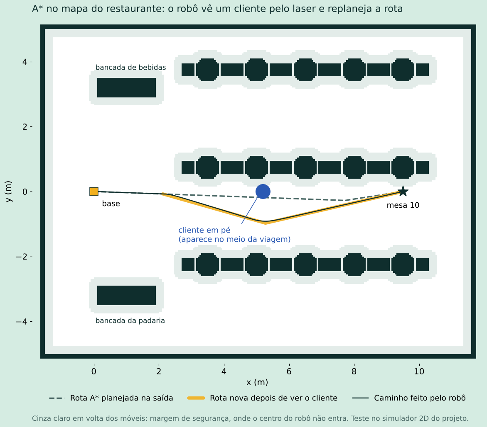

# Robô Garçom Autônomo

Projeto do Laboratório de Robótica Móvel (ENE137, UFJF). Um robô P3-DX recebe pedidos das mesas de um restaurante, reserva os itens no estoque, vai até as estações de coleta, espera a confirmação de que a bandeja foi montada e entrega o pedido na mesa. No caminho, planeja a rota com A* no mapa e usa o laser para parar ou desviar quando aparece alguém na frente.

**Equipe:** Ian (pedidos, estoque, missões e interfaces) e Ana (simulação e navegação).



## Documentação

- [Guia da equipe](docs/GUIA_DA_EQUIPE.md): instalação, como rodar, o que cada parte faz e como enviar código.
- [Cronograma semanal](docs/CRONOGRAMA.md): entregas até 07/12.

## Requisitos

- Ubuntu 20.04
- ROS Noetic (`ros-noetic-desktop-full`, que já traz Gazebo 11, RViz e xacro)

## Como compilar

O repositório fica dentro da pasta `src` de um workspace catkin:

```bash
mkdir -p ~/catkin_ws/src
cd ~/catkin_ws/src
git clone https://github.com/ianvellozo/robo-garcom.git robo-garcom
cd ~/catkin_ws
catkin_make
source devel/setup.bash
```

Se um nó não abrir, confira se os scripts estão executáveis:

```bash
chmod +x ~/catkin_ws/src/robo-garcom/*/scripts/*.py
```

## Como rodar

São três jeitos, do mais leve ao mais completo. Todos sobem o sistema inteiro (pedidos, estoque, missões e telas).

| Comando | O robô | Para quê |
| --- | --- | --- |
| `roslaunch garcom_bringup sim.launch` | Não existe: a viagem é fingida (tempo = distância ÷ velocidade) | Testar telas, fila e estoque em qualquer computador |
| `roslaunch garcom_bringup sim2d.launch` | Simulador 2D leve: anda de verdade, com odometria e laser | Testar navegação e obstáculos rápido, sem Gazebo |
| `roslaunch garcom_bringup gazebo.launch` | P3-DX no restaurante do Gazebo, com RViz mostrando o mapa, o laser e a rota | Apresentação e testes realistas |

Os três aceitam as mesmas opções. Por exemplo, para você fazer os pedidos e montar a bandeja pelas telas:

```bash
roslaunch garcom_bringup gazebo.launch auto_orders:=false auto_pickup:=false
```

Depois abra no navegador do mesmo computador:

| Tela | Endereço | Para quem |
| --- | --- | --- |
| Mesa | http://localhost:8080/mesa | Cliente: toca na sua mesa na planta do salão, escolhe os itens, faz o pedido e acompanha o robô |
| Bancada | http://localhost:8080/bancada | Funcionário: vê o que pôr na bandeja, confirma, ajusta o estoque e vê se o robô parou por obstáculo |

Um tablet fixo numa mesa pode abrir direto no cardápio: http://localhost:8080/mesa?mesa=7. A bancada pode mostrar só uma estação: http://localhost:8080/bancada?estacao=estacao_cafe

**Testar obstáculo** (Gazebo ou simulador 2D), em outro terminal:

```bash
rosrun garcom_simulation obstaculo.py              # cliente em pé na rota, 1,5 m à frente do robô
rosrun garcom_simulation obstaculo.py frente 0.8   # bem perto: o robô freia
rosrun garcom_simulation obstaculo.py 8 0          # num ponto (x, y) do salão
rosrun garcom_simulation obstaculo.py tempo 30     # fica 30 s (o padrão é 15 s; tempo 0 = fica até tirar)
rosrun garcom_simulation obstaculo.py tirar        # tira todos
```

O cliente vai embora sozinho depois do tempo, como uma pessoa de verdade.

**Outras opções:**

```bash
roslaunch garcom_bringup sim.launch deadline_s:=30 order_period_s:=5   # alertas de prazo
roslaunch garcom_bringup gazebo.launch rviz:=false                     # sem o RViz (mais leve)
rosrun garcom_interface interface_node.py      # tela da mesa no terminal
rosrun garcom_interface station_panel.py       # tela da estação no terminal; ENTER confirma
rosservice call /garcom/restock "{item: 'rosquinha', quantity: 5}"
```

Para ver os nós e tópicos, rode `rqt_graph` em outro terminal.

## Pacotes

| Pacote | Responsável | Função |
| --- | --- | --- |
| `garcom_msgs` | Ian | Mensagens, serviços e ações do projeto |
| `garcom_bringup` | Ian | Launches do sistema completo (`sim`, `sim2d`, `gazebo`) |
| `garcom_mission` | Ian | Fila de pedidos, prazos, viagens e rota entre as paradas |
| `garcom_stock` | Ian | Cardápio e estoque |
| `garcom_interface` | Ian | Telas no navegador (mesa e bancada) e versões no terminal |
| `garcom_simulation` | Ana | Restaurante e P3-DX no Gazebo, simulador 2D e obstáculos de teste |
| `garcom_navigation` | Ana | Mapa, A*, controle e parada/desvio de obstáculos |

**Configurações:**

- Cardápio (itens, estação de cada item e estoque inicial): `garcom_stock/config/cardapio.yaml`
- Onde o robô para em cada mesa, bancada e base: `garcom_navigation/config/pontos.yaml`
- Medidas do salão e dos móveis: `garcom_simulation/config/restaurante.yaml`. O mundo do Gazebo e o mapa saem daqui e do `pontos.yaml`; depois de mudar, rode `rosrun garcom_simulation gerar_mundo.py`.
- Velocidade, margem de segurança e distâncias de parada: `garcom_navigation/config/navegacao.yaml`
- Capacidade da bandeja, espera para agrupar e peso do atraso: `garcom_mission/config/missao.yaml`

## Comunicação entre os nós

| Nome | Tipo | De → Para |
| --- | --- | --- |
| `/garcom/orders` | tópico `Order` | tela da mesa → order_queue |
| `/garcom/check_stock` | serviço `CheckStock` | order_queue → stock_server (confere e reserva os itens) |
| `/garcom/restock` | serviço `Restock` | quem quiser repor → stock_server |
| `/garcom/set_stock` | serviço `SetStock` | web_server (botão Estoque) → stock_server |
| `/garcom/stock` | tópico `StockLevels` | stock_server → telas |
| `/garcom/order_status` | tópico `OrderStatus` | order_queue, mission_manager → telas |
| `/garcom/next_orders` | serviço `NextOrders` | mission_manager → order_queue (pega os pedidos mais urgentes que cabem na bandeja) |
| `/garcom/trip` | tópico `Trip` | mission_manager → telas (paradas da viagem atual) |
| `/garcom/go_to_point` | ação `GoToPoint` | mission_manager → navigation |
| `/garcom/robot_at` | tópico `std_msgs/String` | navigation → quem quiser saber onde o robô chegou |
| `/garcom/nav_state` | tópico `std_msgs/String` | navigation → telas (`andando`, `obstaculo`, `desviando`, `recuando`, `sem_caminho`, `parado`) |
| `/garcom/path` e `/map` | tópicos `nav_msgs/Path` e `OccupancyGrid` | navigation → RViz (rota A* e mapa) |
| `/odom`, `/scan` | tópicos `Odometry` e `LaserScan` | Gazebo ou simulador 2D → navigation |
| `/cmd_vel` | tópico `Twist` | navigation → Gazebo ou simulador 2D |
| `/garcom/pickup_request` | tópico `PickupRequest` | mission_manager → tela da bancada (uma comanda, com número) |
| `/garcom/pickup_done` | tópico `PickupDone` | tela da bancada → mission_manager (comanda confirmada) |

## Situação atual (21/10)

- **Fila de pedidos com prazo máximo de entrega:** cronômetro por pedido, alerta aos 70% do prazo, marcação de atraso, atendimento do pedido com menos tempo restante e métricas (tempo médio e % no prazo).
- **Estoque:** reserva os itens quando o pedido é aceito, recusa o pedido se faltar item, avisa quando um item está acabando e aceita reposição.
- **Viagens com vários pedidos:** como um garçom de verdade, o robô junta os pedidos de várias mesas numa viagem só. Ele pega os mais urgentes que cabem na bandeja (8 itens, até 5 mesas), soma os itens de cada bancada ("2 × Café, 3 × Suco"), passa em cada bancada e entrega mesa por mesa. Na base, espera 4 s para juntar pedidos que chegam quase juntos.
- **Pedido novo no meio da viagem:** enquanto o robô ainda está nas bancadas, um pedido que chega e cabe na bandeja entra na mesma viagem. Se a bancada dele ainda vai ser visitada, os itens vão na mesma comanda; se for a bancada onde o robô está, sai uma comanda extra ali ("+ itens"); se for uma que já ficou para trás, o robô volta nela. A rota é refeita e as telas atualizam na hora. Num teste com pedidos das mesas 10 e 15 chegando com 35 s de diferença, a entrega caiu de 152 s (duas viagens) para 129 s (uma viagem).
- **Ordem das paradas:** escolhida para equilibrar a mesa mais perto e o pedido mais atrasado. Cada ordem possível recebe um custo (soma dos tempos de chegada, com peso extra para o atraso previsto) e o robô faz a de menor custo. Até 7 mesas ele testa todas as ordens; acima disso escolhe a próxima parada mais barata. O log compara com a ordem de chegada (ex.: custo 423 contra 593).
- **Restaurante no Gazebo:** salão de 13 × 10 m com 15 mesas (com cadeiras dos lados), duas bancadas e a base do robô, gerado a partir do `pontos.yaml`. O P3-DX tem tração diferencial, laser de 180° na frente (como o SICK do laboratório) e bandeja em cima, com os mesmos plugins da aula 7.
- **Mapa e A\*:** o mapa do salão (formato do `map_server`, o mesmo que o `gmapping` salva) é gerado junto com o mundo. O A\* busca em 8 direções com uma margem de segurança em volta dos móveis e prefere o meio dos corredores. A rota leva menos de 0,1 s para ser calculada.
- **Controle:** o robô segue a rota com *pure pursuit*, lendo a odometria, com aceleração suave por causa da bandeja, e no fim gira para ficar de frente para a mesa.
- **Obstáculos (laser):** se aparece algo novo na rota, o robô replaneja antes de chegar perto (desvio). Se aparece de repente na frente, ele desacelera e para a 45 cm do para-choque. Se o obstáculo continua lá, marca no mapa e procura outro caminho. Se a pessoa está parada no próprio destino, ele espera ela sair. Se alguém aparece encostado na frente, ele dá uma ré curta e devagar (o laser só vê a frente, então ele confere no mapa se atrás está livre). As telas mostram "Robô parado: tem algo no caminho".
- **Telas no navegador:** a da mesa começa pela planta do salão com as 15 mesas, depois vem o cardápio com estoque e o acompanhamento do robô ("Faltam 2 paradas antes da sua"). A da bancada mostra a comanda da viagem com o total e a divisão por mesa, as paradas, os pedidos do salão com alertas e o botão Estoque.
- **Coleta:** a leitura de marcadores ArUco foi retirada do projeto, com o aval do professor. No lugar, a tela da estação confirma a coleta.
- **Testado:** no Gazebo com o RViz, e o ciclo completo e os obstáculos também no simulador 2D (sem nenhuma batida em móveis, mantendo pelo menos 35 cm entre o centro do robô e eles).
- **Próximo passo:** P3-DX real (RosAria e laser), mapa do laboratório com `gmapping` e localização com AMCL.
